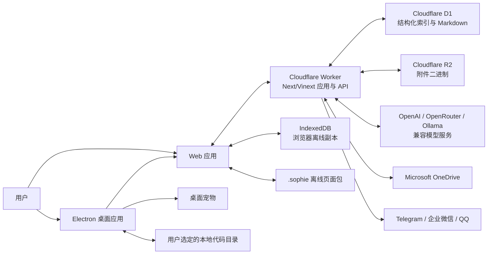
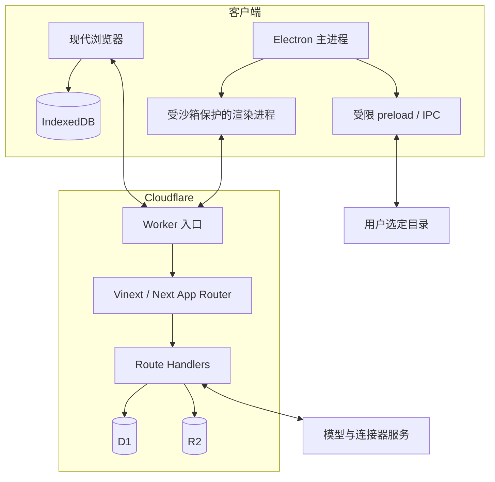
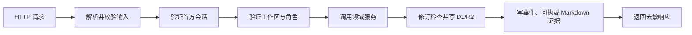
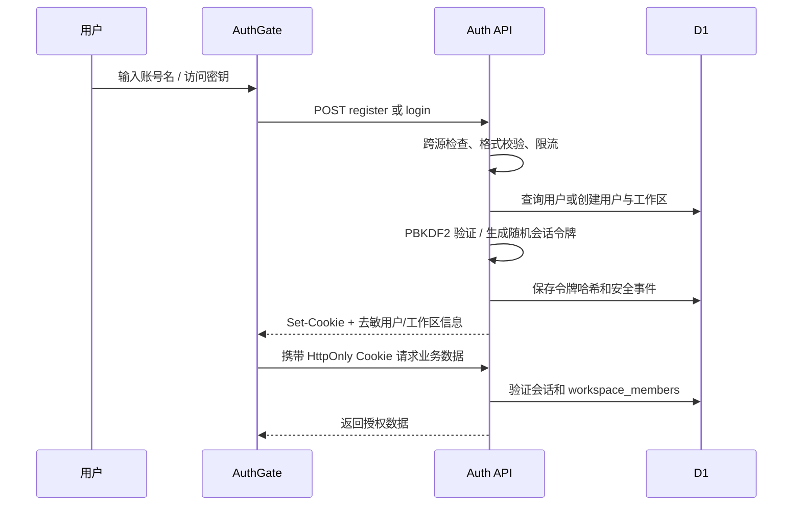
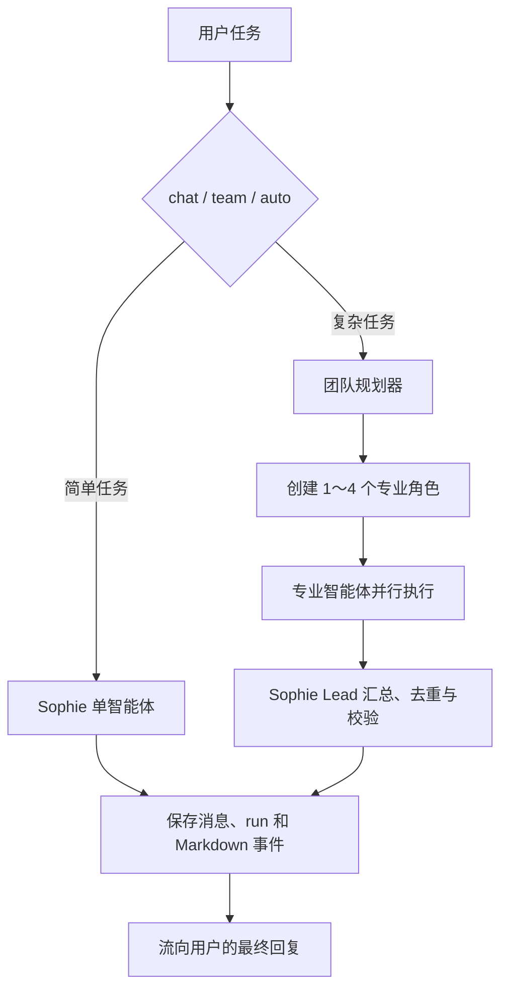
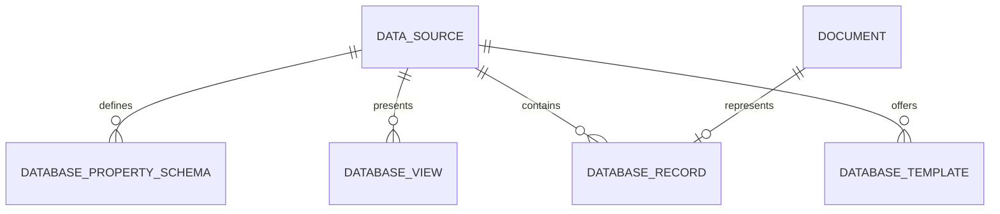
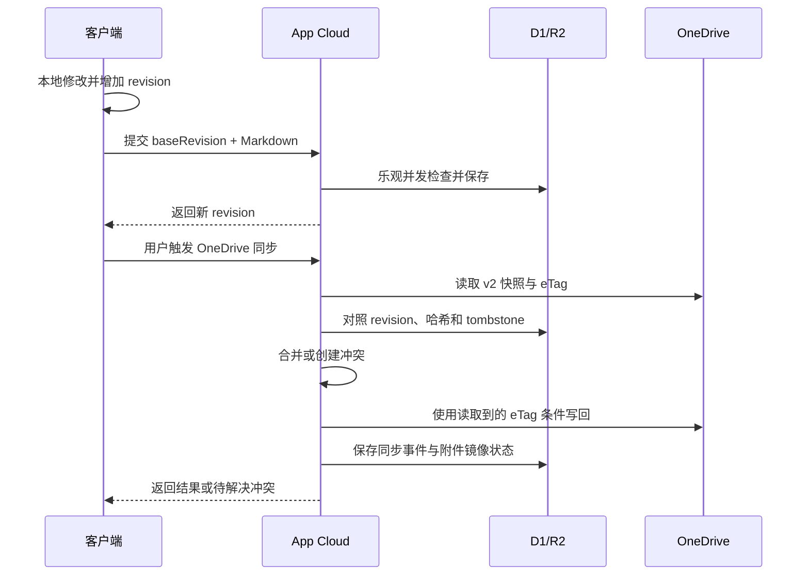
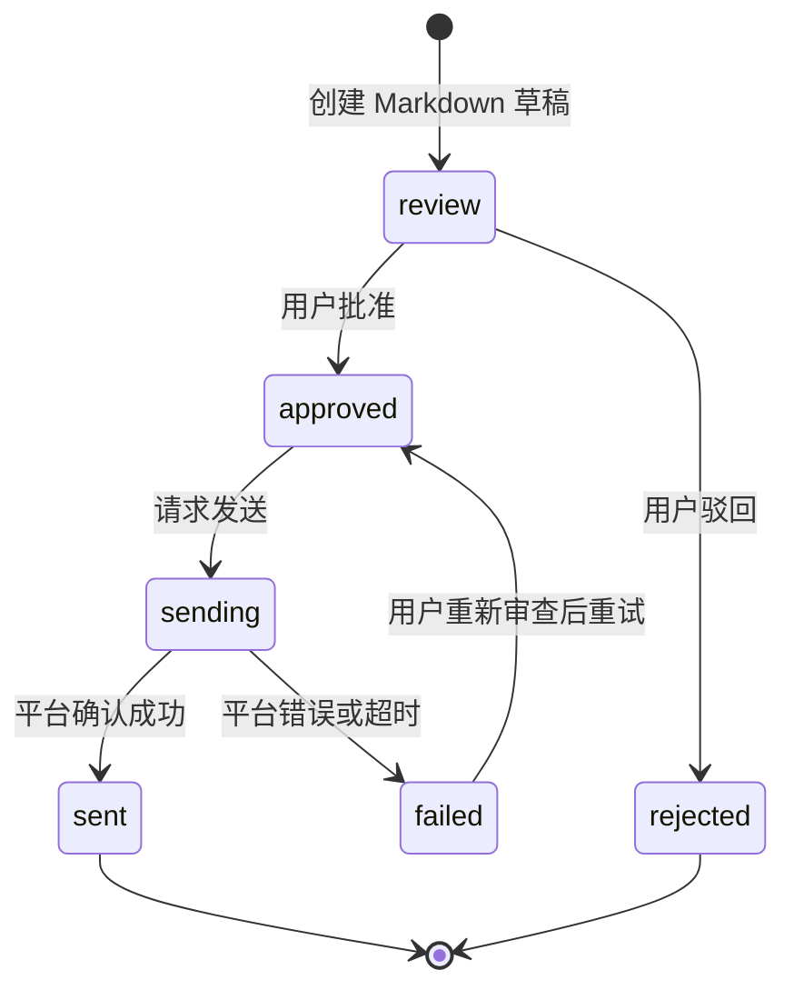

# SuperSophie 总体架构文档

> 文档状态：与当前 `0.3.0` 实现对齐
> 最后更新：2026-07-24
> 适用范围：Web、Cloudflare 云端、Electron 桌面端、离线页面包与第三方连接器

## 1. 项目定位

SuperSophie 是一个以对话为主入口、以 Markdown 为数据真相源的个人智能工作空间。用户可以直接与 Sophie 对话，也可以进入笔记、数据库、智能体团队、代码工作台和连接器等工作区。

系统当前包含六个核心能力：

1. **首方用户系统**：账号、访问密钥、会话、工作区和成员权限完全由 SuperSophie 管理，不依赖 ChatGPT 登录。
2. **Markdown 工作空间**：页面、知识、智能体记录、消息草稿和代码文件均以 Markdown 或 Markdown 包装格式保存。
3. **多智能体执行**：Sophie 可以判断任务复杂度，创建 1～4 个专业角色并行分析，再由主智能体汇总。
4. **Notion 式数据库**：记录本身是页面，支持属性、筛选、排序、分组、模板和多种视图。
5. **跨设备与离线能力**：App Cloud 负责云端主副本，IndexedDB 提供本地副本，`.sophie` 文件用于完整页面离线传输。
6. **桌面与外部集成**：Electron 提供系统托盘、桌面宠物、本地代码目录和文件关联；连接器提供 OneDrive、Telegram、企业微信和 QQ 能力。

当前产品的主页面是对话页。用户可以在语音交互形态和文字输入形态之间切换；关闭主窗口后，桌面端可以继续保留 Sophie 桌面宠物。

## 2. 架构原则

### 2.1 Markdown 是内容真相源

- 页面正文、数据库记录正文、智能体计划/日志、社交消息草稿、同步回执和安全证据优先保存为 Markdown。
- D1 中的 JSON 字段、普通文本字段和关系表主要用于查询、权限、状态机与索引，不取代 Markdown 正文。
- 块使用稳定 ID，页面属性使用 YAML frontmatter，因此同一内容既能被人阅读，也能被程序解析、同步和审计。

### 2.2 本地优先，但云端可协作

- 浏览器使用 IndexedDB 保存可用的本地副本。
- App Cloud 中的 D1/R2 是当前跨设备云端主副本。
- OneDrive 是用户显式触发的第二同步目标，不直接替代 App Cloud 的权限与索引层。
- `.sophie` 文件允许用户脱离网络传输一个可验证的完整页面。

### 2.3 所有外部副作用必须可审查

- 智能体生成外发消息时只创建 Markdown 草稿。
- 消息必须进入 outbox，经用户批准后才能发送。
- 智能体不能声称已执行并未发生的外部操作。
- Web 端不能执行任意 Shell 命令；桌面本地代码模式只开放受控命令。

### 2.4 工作区是安全与数据隔离边界

- 用户可以属于多个工作区。
- 每个 API 都从服务端会话解析用户身份，并验证工作区成员关系。
- `owner`、`editor`、`viewer` 决定可执行操作；`viewer` 不允许写入。
- 模型密钥、社交连接器凭据和 OneDrive OAuth 令牌都按工作区隔离。

## 3. 系统上下文



### 3.1 主要信任边界

| 边界 | 可信内容 | 不应跨越边界的内容 |
| --- | --- | --- |
| 浏览器 ↔ Worker | 会话 Cookie、业务请求、已授权页面数据 | 密钥明文、OAuth refresh token |
| Worker ↔ 模型提供商 | 当前任务所需上下文、模型请求 | 无关工作区内容、连接器凭据 |
| Worker ↔ 社交平台 | 用户批准的消息与必要目标信息 | 未批准草稿、模型密钥 |
| Worker ↔ OneDrive | 工作区快照、附件、OAuth 访问令牌 | 其他工作区数据 |
| Electron ↔ 本地目录 | 用户明确选择目录内的文件 | 目录外路径、任意系统命令 |
| `.sophie` 文件 ↔ App | 经过哈希和引用校验的页面与附件 | 未验证的块结构和超限载荷 |

## 4. 部署与运行时拓扑



### 4.1 Web 运行时

- UI 使用 React 19、Next.js App Router 和 TypeScript。
- Cloudflare 部署由 Vinext、Vite 和 Cloudflare Vite 插件生成。
- `worker/index.ts` 是 Worker 入口；图片变换路由由 Worker 处理，其余请求交给应用路由。
- `app/api/**/route.ts` 作为同一部署中的服务端 API。
- D1 绑定名为 `DB`，R2 绑定名为 `FILES`。

### 4.2 桌面运行时

- Electron 不是第二套业务后端，而是承载同一 Web 产品的桌面壳。
- 正式版加载已发布的 SuperSophie 产品地址；开发版默认加载本地开发服务器。
- 主窗口使用 `contextIsolation: true`、`nodeIntegration: false`、`sandbox: true`。
- preload 只暴露经过约束的 IPC：桌面宠物、窗口控制、`.sophie` 文件、本地代码目录、固定任务命令等。
- 桌面端注册 `.sophie` 文件关联，并通过单实例队列把待打开文件传给应用。
- 网络加载失败时显示本地离线壳，用户可重试联网或打开离线包。

## 5. 分层架构

| 层 | 职责 | 主要位置 |
| --- | --- | --- |
| 展示层 | 对话首页、笔记、数据库视图、智能体、代码、连接器和设置 | `app/workspace.tsx`、`app/auth-gate.tsx` |
| 路由/API 层 | 输入校验、会话解析、权限检查、HTTP 语义 | `app/api/**/route.ts` |
| 领域服务层 | 智能体编排、数据库查询、同步、连接器发送、代码文件处理 | `lib/agents`、`lib/database`、`lib/connectors`、`lib/code-files.ts` |
| 身份与安全层 | 密钥派生、会话、限流、跨源写保护、凭据加密 | `lib/auth.ts`、`lib/auth-crypto.ts`、`lib/connectors/crypto.ts` |
| 数据访问层 | D1 SQL、修订控制、删除墓碑、工作区资源访问 | 各 API 和 `lib/workspace-resource.ts` |
| 离线/封装层 | IndexedDB 副本、`.sophie` 导入导出和完整性校验 | `lib/offline-store.ts`、`lib/sophie-package.ts` |
| 平台适配层 | Cloudflare Worker、D1、R2、Electron、外部 API | `worker`、`desktop`、连接器适配器 |

依赖方向原则为：UI 调用 API；API 组合领域服务；领域服务访问数据和平台适配器。浏览器不会直接持有数据库、模型或连接器密钥。

## 6. 源码目录

```text
SuperSophie/
├─ app/
│  ├─ api/                    # 服务端 Route Handlers
│  ├─ auth-gate.tsx           # 登录、注册、工作区切换和账户安全入口
│  ├─ page.tsx                # 产品根页面
│  ├─ layout.tsx              # 全局布局与元数据
│  └─ workspace.tsx           # 主要交互工作区
├─ lib/
│  ├─ agents/                 # 模型目录、智能体编排和 Markdown 运行记录
│  ├─ connectors/             # 社交发送、OneDrive、快照与凭据
│  ├─ database/               # 属性系统和查询执行
│  ├─ auth.ts                 # 会话与权限入口
│  ├─ auth-crypto.ts          # 密钥派生、令牌哈希和安全工具
│  ├─ code-files.ts           # 云端与桌面代码文件约束
│  ├─ offline-store.ts        # IndexedDB 本地副本
│  ├─ sophie-package.ts       # .sophie 编解码与完整性校验
│  ├─ sync-tombstones.ts      # 删除传播
│  └─ workspace-resource.ts   # 工作区资源授权
├─ drizzle/                   # D1 schema 迁移
├─ worker/                    # Cloudflare Worker 入口
├─ desktop/                   # Electron 主进程、preload 和离线壳
├─ public/                    # 静态资源
├─ tests/                     # 单元、路由、安全和渲染测试
├─ docs/                      # 产品与子系统文档
├─ .openai/hosting.json       # Sites/Cloudflare 资源绑定
└─ package.json               # Web/桌面构建入口与 electron-builder 配置
```

## 7. 前端应用架构

### 7.1 根入口

`app/page.tsx` 的结构为：

```text
AuthGate
└─ SophieWorkspace
   ├─ ConversationHome
   ├─ NotesView
   ├─ DatabaseView
   ├─ AgentsView
   ├─ CodeView
   ├─ ConnectorsView
   └─ Settings / Search / Modal layers
```

`AuthGate` 负责：

- 注册、登录和退出。
- 恢复当前会话。
- 工作区选择。
- 访问密钥轮换。
- 当前设备及其他会话的撤销。

`SophieWorkspace` 负责产品主体导航、对话状态以及各工作视图。目前多数产品界面集中在该客户端组件，业务数据通过 `/api/*` 获取和写入。

### 7.2 主对话页

主页面默认进入 `ConversationHome`：

- 文字输入直接提交到 `/api/chat`。
- 会话及消息在服务端持久化。
- 用户可以选择普通对话、团队模式或自动模式。
- 语音/文字是交互方式差异，不改变后端对话和智能体运行模型。

### 7.3 笔记与块模型

- 页面保存为带 frontmatter 的 Markdown。
- 块 ID 写入 HTML 注释，保证编辑、同步和重建时的稳定引用。
- 本地编辑先形成离线副本，随后与 App Cloud 修订同步。
- 图片和文件块只在 Markdown 中保存稳定附件 ID；实际字节位于 R2 或 `.sophie` 包内。

### 7.4 数据库界面

当前数据库目标对齐 Notion 式工作流，支持以下 11 类视图：

| 视图 | 主要用途 |
| --- | --- |
| Table | 高密度字段编辑 |
| Board | 按属性分栏管理 |
| Timeline | 时间区间规划 |
| Calendar | 日期排期 |
| List | 简洁记录列表 |
| Gallery | 卡片和媒体浏览 |
| Chart | 聚合可视化 |
| Form | 对外或内部数据录入 |
| Map | 地理字段展示 |
| Feed | 时间流内容浏览 |
| Dashboard | 多组件汇总 |

属性系统、嵌套 AND/OR 筛选、多字段排序、分组/子分组、条件颜色、关系、汇总、公式、唯一 ID、按钮和数据库模板由数据库领域模块统一处理。数据库记录本身仍是可打开和编辑的 Markdown 页面。

## 8. 服务端 API

所有业务 API 均要求首方会话，并在服务端验证工作区成员身份；公开的注册、登录接口除外。

| 路径 | 方法 | 职责 |
| --- | --- | --- |
| `/api/auth/register` | POST | 创建 SuperSophie 用户和初始工作区 |
| `/api/auth/login` | POST | 使用账号名和访问密钥登录 |
| `/api/auth/logout` | POST | 撤销当前会话 |
| `/api/auth/session` | GET / POST | 查询会话、工作区和撤销设备会话 |
| `/api/auth/key` | POST | 轮换账户访问密钥 |
| `/api/pages` | GET / POST / DELETE | 页面读取、保存和删除 |
| `/api/assets` | GET / POST | R2 附件读取和上传 |
| `/api/database` | GET / POST / DELETE | 数据源、schema、视图、记录与模板 |
| `/api/chat` | GET / POST | 会话历史、普通/团队智能体执行 |
| `/api/models` | GET / POST / DELETE | 工作区模型配置和模型目录 |
| `/api/code` | GET / POST / DELETE | App Cloud 代码项目与文件 |
| `/api/outbox` | GET / POST / PATCH / DELETE | 消息草稿、批准、驳回和重试 |
| `/api/connectors` | GET / POST / DELETE | 连接器配置状态与凭据更新 |
| `/api/connectors/send` | POST | 发送已批准 outbox 项 |
| `/api/connectors/onedrive/authorize` | GET | 创建 OAuth + PKCE 授权请求 |
| `/api/connectors/onedrive/callback` | GET | 处理授权回调并保存加密令牌 |
| `/api/connectors/onedrive/sync` | POST | 用户触发的双向同步 |
| `/api/connectors/onedrive/conflicts` | GET / PATCH | 查看和解决同步冲突 |
| `/api/connectors/onedrive` | DELETE | 断开 OneDrive |

统一的 API 处理顺序为：



## 9. 首方身份与工作区系统

### 9.1 身份模型

用户使用唯一账号名和高熵访问密钥登录。访问密钥不是第三方 API Key，也不与 ChatGPT/OpenAI 账号关联。

- 访问密钥通过 PBKDF2-HMAC-SHA256 派生，按 Cloudflare Workers Web Crypto 上限迭代 100,000 次，并为每个用户使用随机盐；访问密钥本身由 32 字节安全随机数生成。
- 登录成功后生成 256 位随机会话令牌。
- D1 只保存会话令牌的 SHA-256 哈希。
- Cookie 使用 `HttpOnly`、`SameSite=Strict`；HTTPS 下使用 `Secure` 和 `__Host-` 前缀。
- 用户可轮换访问密钥；旧密钥立即失效。
- 用户可查看并撤销其他设备会话。
- 登录尝试按账号名和来源 IP 限流；公开注册按来源网络限制 24 小时内创建数量。

### 9.2 注册与登录流程



### 9.3 工作区角色

| 角色 | 读取 | 编辑内容 | 管理设置/成员 |
| --- | --- | --- | --- |
| owner | 是 | 是 | 是 |
| editor | 是 | 是 | 受限 |
| viewer | 是 | 否 | 否 |

当前账号系统已独立运行，但自助邮箱找回、邀请邮件、企业 SSO 和完整成员管理界面仍属于后续能力。

## 10. Markdown 数据内核

### 10.1 页面形态

概念上的页面格式如下：

```markdown
---
sophie: 1
id: "doc_123"
title: "项目计划"
kind: "page"
revision: 7
updatedAt: "2026-07-22T10:00:00.000Z"
properties:
  "status": "进行中"
---

<!-- sophie:block=block_1 type=heading -->
## 项目计划

<!-- sophie:block=block_2 type=text -->
这是页面正文。
```

数据库会把 frontmatter 中可查询的属性投影到结构化字段；当投影和正文不一致时，Markdown 内容仍是正文真相源，结构化字段需要重新派生。

### 10.2 修订与并发

- 可变资源带有递增 `revision`。
- 客户端提交时携带 `baseRevision`。
- 服务端只在基线仍匹配时提交更新。
- 同一 revision 出现不同内容时，不静默覆盖；同步层保留双方 Markdown 并创建冲突。
- 删除使用 `workspace_tombstones` 传播，避免离线设备重新上传已经删除的对象。

## 11. 数据架构

D1 当前包含 29 张业务表，按领域分组如下。

### 11.1 身份与权限

| 表 | 职责 |
| --- | --- |
| `users` | 首方用户、账号名和访问密钥派生结果 |
| `workspaces` | 工作区根实体 |
| `workspace_members` | 用户、工作区和角色关系 |
| `sessions` | 会话令牌哈希、设备和过期信息 |
| `auth_login_limits` | 登录/注册限流计数 |
| `security_events` | 注册、登录、轮换、撤销等 Markdown 安全记录 |

### 11.2 页面与知识

| 表 | 职责 |
| --- | --- |
| `documents` | 页面、知识、计划和其他 Markdown 文档；包含 revision 与查询属性 |

### 11.3 对话与智能体

| 表 | 职责 |
| --- | --- |
| `conversations` | 用户对话容器 |
| `chat_messages` | 对话消息和关联运行信息 |
| `agent_runs` | 目标、状态、父子关系、模型和审批信息 |
| `agent_run_events` | 规划、执行、合成等不可变 Markdown 事件 |

### 11.4 数据库引擎

| 表 | 职责 |
| --- | --- |
| `data_sources` | 数据库根定义 |
| `database_property_schemas` | 属性名称、类型和配置 |
| `database_views` | 视图类型、筛选、排序、分组和布局 |
| `database_records` | 记录属性投影及对应页面关系 |
| `database_templates` | 属性预设与 Markdown 正文模板 |

### 11.5 代码工作台

| 表 | 职责 |
| --- | --- |
| `code_projects` | 跨设备的 App Cloud 代码项目 |
| `code_files` | 文件路径、`content_markdown` 真相源、派生纯文本和 revision |

### 11.6 连接器与同步

| 表 | 职责 |
| --- | --- |
| `connector_outbox` | 消息审批状态、渠道、目标和修订 |
| `connector_outbox_details` | Markdown 消息正文与发送参数 |
| `connector_delivery_attempts` | 不可变发送成功/失败回执 |
| `connector_credentials` | 按工作区加密的连接器与模型凭据 |
| `connector_oauth_states` | 有时效的 OAuth state 与 PKCE 上下文 |
| `connector_sync_events` | 同步方向、结果和 Markdown 回执 |
| `connector_sync_conflicts` | App Cloud 与外部副本冲突内容 |
| `workspace_tombstones` | 跨设备删除传播 |

### 11.7 附件

| 表 | 职责 |
| --- | --- |
| `assets` | MIME、大小、SHA-256、R2 key 等元数据 |
| `asset_ownership` | 附件与工作区的所有权 |
| `document_assets` | 页面与附件的引用关系 |

附件字节不进入 D1；D1 保存元数据和关系，R2 保存二进制内容。

## 12. 智能体运行时

### 12.1 模式

- `chat`：单一 Sophie 直接回答。
- `team`：强制创建专业角色团队。
- `auto`：根据任务长度、复杂度和指令特征决定是否使用团队。
- `/team` 或 `/agent` 可显式触发团队模式。

### 12.2 团队执行流程



实现要点：

- 使用 `@openai/agents` 作为智能体运行基础。
- 模型目录可解析 OpenAI、OpenRouter、Ollama 和自定义 OpenAI-compatible 端点。
- 自定义远程端点必须是公共 HTTPS 地址，服务端阻止私网/本地地址以降低 SSRF 风险。
- 模型密钥只保存在加密凭据中，不返回浏览器，也不会写入运行日志。
- 专业角色的输出由 Lead 合并；外部副作用仍须进入审批流程。

当前团队运行是在一次服务端请求内完成的并行编排，不是持久化后台任务队列。长时间自治、定时任务、断点恢复和跨节点调度是后续运行时扩展点。

## 13. 数据库引擎

### 13.1 领域模型



- `data_source` 决定记录集合。
- property schema 定义属性类型与约束。
- record 保存可查询属性，并关联一个 Markdown 页面。
- view 只描述呈现和查询方式，不复制记录。
- template 保存默认属性与 Markdown 初始正文。

### 13.2 查询能力

- 23 类属性。
- 最多三层嵌套的 AND/OR 筛选。
- 多字段排序。
- 分组和子分组。
- 条件颜色。
- relation、rollup、formula、unique ID 和 button 等高级属性。

筛选、排序和属性计算位于 `lib/database`；前端各视图共享同一套查询结果，避免每个视图实现不同的数据语义。

## 14. 离线、`.sophie` 与同步

### 14.1 本地副本

浏览器通过 `lib/offline-store.ts` 在 IndexedDB 中保存页面副本和待同步状态。离线编辑不要求即时连接服务器；恢复网络后使用 revision 和内容哈希提交。

### 14.2 `.sophie` v1 文件

`.sophie` 是单页面可移植容器：

```text
SOPHIE/1
{ UTF-8 JSON container }
```

容器包含：

- `manifest`：包 ID、版本、导出时间、页面 ID、内容哈希和附件清单哈希。
- `page`：标题、Markdown、块索引、属性和 revision。
- `assets`：稳定附件 ID、文件名、MIME、大小、SHA-256 与 Base64 字节。

导入时会校验：

- 页面 Markdown SHA-256。
- 块结构重建结果。
- 每个附件的 SHA-256 与声明大小。
- 附件清单哈希。
- Markdown 中的附件引用完整性。

大小限制：单附件 32 MB、附件合计 64 MB、容器解析上限 96 MB；桌面文件读取另有 100 MB 总上限。后续可升级为 ZIP 容器，但必须保留 `SOPHIE/1` 兼容识别。

### 14.3 App Cloud 与 OneDrive 同步



同步规则：

1. 以 `baseRevision` 做乐观并发控制。
2. 同 revision 不同哈希视为冲突，不使用最后写入静默覆盖。
3. 删除通过 tombstone 传播；更新和删除按较新 revision 判定。
4. OneDrive v2 快照按依赖顺序合并；旧 v1 快照首次升级前归档。
5. 写 OneDrive 时使用 eTag 条件写，遇到并发修改会重新读取和重试。
6. 附件按 SHA-256 内容寻址，在 R2 与 OneDrive 之间校验镜像。
7. 获取 OneDrive 预授权附件时不会把 OAuth Bearer Token 转发给预授权 URL。

## 15. 连接器架构

### 15.1 外发消息状态机



每次发送尝试都有不可变 Markdown 回执。回执记录状态、时间、平台响应摘要和可诊断错误，但不保存凭据。

### 15.2 当前连接器

| 连接器 | 实现方式 | 当前方向 |
| --- | --- | --- |
| Telegram | 官方 Bot API | 外发 |
| 企业微信 | 官方群机器人 Webhook | 外发 |
| QQ | 官方机器人 API | 外发 |
| OneDrive | OAuth 2.0 Authorization Code + PKCE | 双向工作区同步 |

连接器凭据使用 AES-256-GCM 加密保存；浏览器只能看到是否已配置和必要的非秘密元数据。当前不包含社交平台入站 webhook、自动回复和后台定时发送。

## 16. 代码工作台

代码工作台存在两种边界不同的模式。

### 16.1 App Cloud 模式

- `code_projects` 与 `code_files` 跨设备保存。
- `content_markdown` 是文件内容真相源，`content_text` 是编辑器派生值。
- 更新使用 revision 防止静默覆盖。
- Web 端不执行这些代码。

### 16.2 桌面本地模式

- 用户必须手动选择一个目录。
- Electron 主进程以 `realpath` 校验所有目标都留在选择目录内。
- 忽略 `.git`、`node_modules` 和构建产物等目录，不跟随符号链接。
- 只允许支持的文本文件扩展名；最多读取 500 个文件，单文件不超过 2 MB。
- 写入前比较 SHA-256，发现外部修改则返回冲突。
- 保存使用临时文件和原子重命名。
- 只开放 `test`、`typecheck`、`lint` 三类固定命令；最长 5 分钟，输出最多 1 MB。
- Agent Review 调用真实 `/api/chat` 团队模式，只生成修改建议，不自动写入或执行任意命令。

## 17. 桌面专属能力

### 17.1 桌面宠物

- 主窗口关闭后可继续保留透明、置顶的 Sophie 桌面宠物。
- 是否启用宠物保存在桌面端 `desktop-settings.json`。
- 宠物可以唤回主窗口；完全退出通过托盘菜单或显式退出操作完成。
- 宠物窗口与主业务窗口分离，避免窗口关闭等同于结束桌面陪伴。

### 17.2 窗口与导航安全

- 拒绝应用内任意新窗口。
- 主窗口导航仅允许产品源或本地开发源。
- 外部链接交给系统浏览器处理。
- preload API 采用显式函数白名单，不向渲染进程暴露 Node.js 或通用 IPC。

## 18. 安全架构

| 风险 | 当前控制 |
| --- | --- |
| 密钥数据库泄露 | PBKDF2 高迭代、随机盐；不保存访问密钥明文 |
| 会话表泄露 | 只保存 256 位随机令牌的 SHA-256 哈希 |
| Cookie 窃取/跨站提交 | HttpOnly、SameSite=Strict、HTTPS Secure、跨源写保护 |
| 跨工作区越权 | 每个 API 服务端验证 session、workspace 和 role |
| 登录爆破/批量注册 | 账号+IP 登录限流、来源网络注册限流、安全事件记录 |
| 连接器密钥泄露 | AES-256-GCM 服务端加密，API 返回去敏状态 |
| 模型端点 SSRF | 自定义远程端点要求公共 HTTPS，阻止私网/本地目标 |
| 智能体误发送 | outbox 审批状态机，未批准内容不能发送 |
| Web 任意代码执行 | 云端代码不执行；无通用 Shell API |
| 桌面目录逃逸 | 用户选目录、realpath 边界、扩展名/大小/数量限制 |
| 文件静默覆盖 | revision 或 SHA-256 冲突检查、原子保存 |
| 离线包篡改/压缩炸弹 | 哈希、引用、结构与严格大小限制 |
| Electron 渲染进程突破 | context isolation、sandbox、无 Node integration、受限 preload |

安全事件、同步回执和发送回执都应保持可审计，但其中不能写入原始密钥、Cookie、OAuth token 或完整敏感平台响应。

## 19. 构建、发布与环境

### 19.1 主要命令

| 命令 | 用途 |
| --- | --- |
| `pnpm dev` | 启动 Web 开发环境 |
| `pnpm build` | 构建 Cloudflare/Sites Web 产物 |
| `pnpm test` | 执行测试套件 |
| `pnpm desktop:pack` | 构建 Windows Electron 安装包 |

### 19.2 产物

- Web/Sites 构建输出到 `dist/`。
- Electron 构建输出到 `desktop-dist/`。
- D1 schema 通过 `drizzle/` 中的迁移管理。
- Cloudflare 资源绑定在 `.openai/hosting.json` 中声明。
- 当前公共产品地址由 Sites 承载，但应用内数据访问由 SuperSophie 首方用户系统保护，不使用 ChatGPT 身份作为应用登录。

### 19.3 配置类别

运行环境可配置：

- D1 与 R2 绑定。
- OpenAI/OpenRouter/Ollama 或兼容模型目录。
- Telegram、企业微信、QQ 凭据。
- OneDrive OAuth 客户端配置。
- 凭据加密主密钥。
- Electron 正式版产品 URL 覆盖值。

秘密应只存在于部署平台 Secret 或本地安全配置中，不进入 Git、前端 bundle、Markdown 文档或日志。

## 20. 验证策略

当前测试覆盖重点包括：

- 注册、登录、会话、访问密钥轮换和限流。
- 页面与数据库 API 的工作区成员权限。
- 数据库属性、筛选和视图逻辑。
- revision、删除墓碑和 OneDrive 冲突合并。
- outbox 审批、连接器发送与回执。
- 附件权限、哈希和 `.sophie` 完整性。
- Electron 导航、preload、目录边界和本地命令限制。
- 代码项目修订及渲染 HTML 的关键行为。

发布前的最低验证基线为：测试套件通过、Web 构建成功、Electron 打包成功，并对注册→登录→对话→退出的主链路做一次真实环境冒烟测试。

## 21. 当前实现边界

以下内容尚未完成，不应在产品说明中描述为已经可用：

- 持久化的长时间后台 Agent 队列、定时执行和断点恢复。
- 智能体在运行过程中自行修改生产代码或绕过用户审批执行外部副作用。
- 微信个人号直连；当前支持的是企业微信群机器人。
- 社交连接器的入站 webhook 和自动回复。
- 自助邮箱找回、邮件验证、工作区邀请和企业 SSO。
- 完整自托管对象存储适配器；当前主实现是 D1/R2，OneDrive 是已实现的外部同步目标。
- Web 浏览器中的任意代码执行沙箱。
- `.sophie` 多页面工作区容器；当前格式以完整单页面传输为核心。

## 22. 推荐的演进方向

1. 将 `app/workspace.tsx` 按对话、笔记、数据库、智能体、代码和连接器拆分为独立特性模块，降低主组件耦合。
2. 为智能体运行引入持久化队列、租约、重试、取消、断点与预算模型，使“超级智能体”从请求内团队升级为可恢复任务系统。
3. 在现有工作区成员模型上补齐邀请、角色管理、账户恢复和可选 MFA。
4. 把连接器统一为 manifest + capability + credential schema + delivery adapter，便于扩展 Slack、Teams、邮箱等渠道。
5. 把 App Cloud、OneDrive 和未来 S3/WebDAV 抽象为统一同步适配器，同时保持 Markdown/revision/tombstone 协议不变。
6. 为 `.sophie` 增加多页面 ZIP 版本、增量附件和可选签名，同时继续兼容 v1。
7. 将运行事件、同步事件和发送事件汇聚到统一可观测层，增加 trace、耗时、模型成本和错误率指标。

## 23. 子系统文档索引

- [产品规格](./PRODUCT_SPEC.md)
- [身份与工作区](./AUTH_AND_WORKSPACES.md)
- [智能体运行时](./AGENT_RUNTIME.md)
- [数据库引擎](./DATABASE_ENGINE.md)
- [连接器](./CONNECTORS.md)
- [模型配置](./MODEL_CONFIGURATION.md)
- [代码工作台](./CODE_WORKBENCH.md)
- [桌面应用](./DESKTOP.md)

本文档描述整体边界和模块关系；子系统文档负责更细的业务规则、接口契约和操作说明。若两者与代码不一致，应先以迁移、API 路由和测试所反映的当前实现为准，再同步修正文档。
